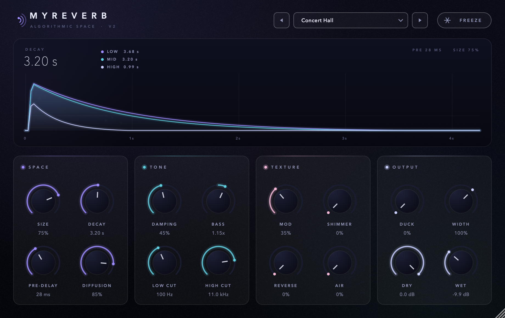
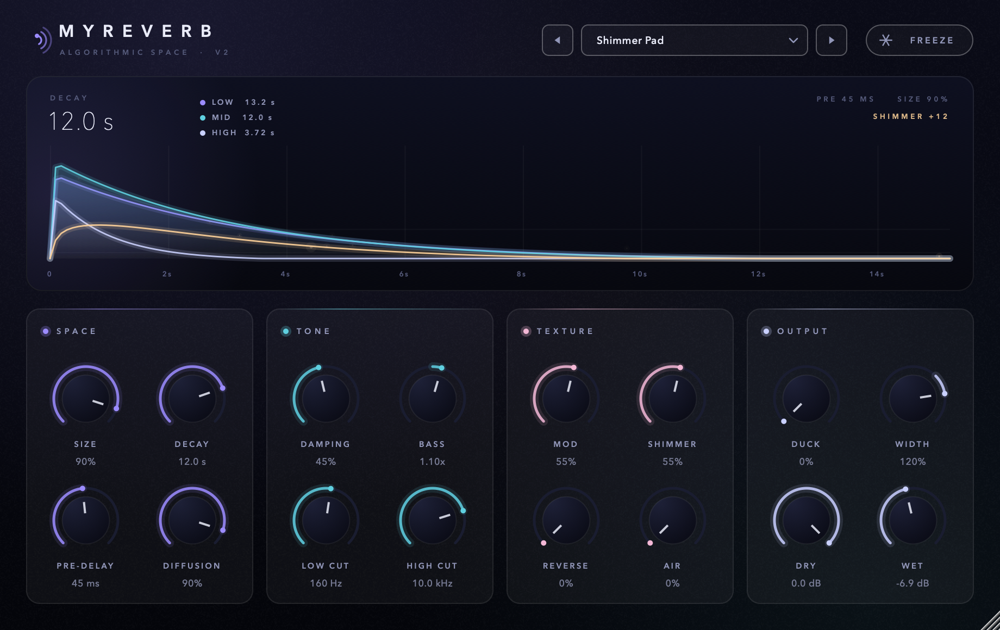
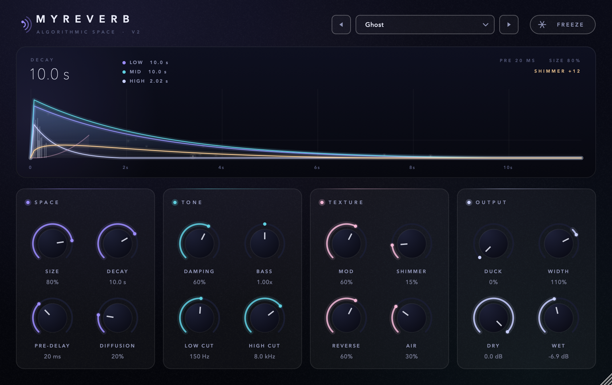
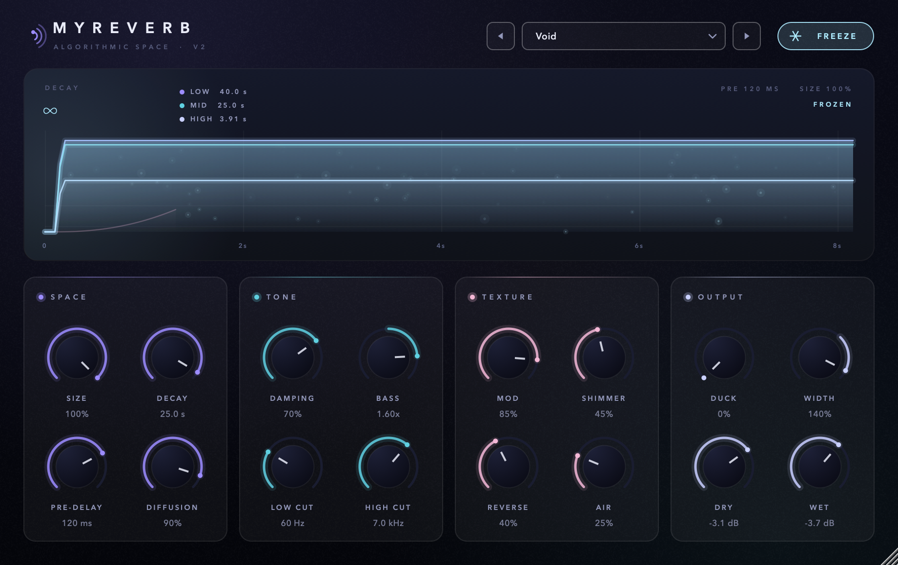

# MyReverb

**A lush stereo algorithmic reverb for macOS (AU / VST3 / Standalone), built with JUCE.**



MyReverb goes from small rooms to huge, never-ending shimmer clouds. Under the hood it's a
16-line modulated feedback delay network (FDN) fed by a 4-stage diffuser. On top of that it adds
three-band decay, a shimmer that feeds back into the tank, reversed-input swells, ducking and
an infinite freeze.

The UI ("Nocturne") draws the reverb tail live: layered bass / mid / air decay curves,
shimmer bloom, reverse swell and early-reflection taps, with particles that light up
with the wet signal. The window can be resized from 75% to 175%, and everything is drawn as
vectors.

---

## What it does

- **Space**: Size goes from small room to cathedral. Decay runs from 0.2 s to 30 s (RT60).
  Diffusion goes from separate echoes to a smooth wash.
- **Tone**: separate decay times for the low, mid and high bands (*Damping*, *Bass*), plus
  low and high cuts on the wet signal only.
- **Texture**
  - *Mod*: modulates the delay lines so the tail sounds chorused, not metallic.
  - *Shimmer*: octave-up pitch shifting inside the feedback loop, so octaves pile up into a
    rising cloud.
  - *Reverse*: splices of reversed input that swell into the tail.
  - *Air*: grain that rides the tail.
- **Output**: input-keyed *Duck* keeps the wet signal out of the way while you play. Also
  Width (0–150%) and separate Dry and Wet gains.
- **Freeze**: holds the current tail forever and mutes the input, so you can play over a drone.
- **13 factory presets**: Concert Hall, Velvet Room, Bright Plate, Vocal Plate, Dark Chamber,
  Cathedral, Ambience, Shimmer Pad, Infinite Shimmer, Dreaming, Ghost, Ducked Bloom, Void.

| Shimmer Pad | Ghost (low diffusion) | Void + Freeze |
|---|---|---|
|  |  |  |

## Parameters

| Section | Control | Range | Default |
|---------|---------|-------|---------|
| Space   | Size      | 0–100% (room → cathedral) | 75% |
|         | Decay     | 0.2–30 s (RT60, mid band) | 3.2 s |
|         | Pre-Delay | 0–250 ms | 28 ms |
|         | Diffusion | 0–100% (discrete echoes → silk) | 85% |
| Tone    | Damping   | 0–100% (how much faster the highs decay) | 45% |
|         | Bass      | 0.5–2.0× low-band decay | 1.15× |
|         | Low Cut   | 20–1000 Hz (wet only) | 100 Hz |
|         | High Cut  | 1–20 kHz (wet only) | 11 kHz |
| Texture | Mod       | 0–100% delay-line modulation | 35% |
|         | Shimmer   | 0–100% octave-up feedback | 0% |
|         | Reverse   | 0–100% reversed-input splices | 0% |
|         | Air       | 0–100% grain that rides the tail | 0% |
| Output  | Duck      | 0–100% input-keyed wet ducking | 0% |
|         | Width     | 0–150% | 100% |
|         | Dry / Wet | gain | 0 dB / −10 dB |
| —       | Freeze    | infinite sustain, input muted | off |

## How it works

The DSP lives in [`Source/ReverbDSP.h`](Source/ReverbDSP.h) and doesn't depend on JUCE.

1. **Input**: the reverse splicer (sin² crossfades) feeds a fractional pre-delay that glides
   smoothly when changed, without zipper noise.
2. **Diffuser**: the stereo input is spread across 16 channels and passed through 4 stages of
   jittered delays, polarity flips and a 16-point Hadamard mix. *Diffusion* crossfades which
   stage feeds the tank.
3. **Late tank**: 16 delay lines with modulated, Hermite-interpolated reads. Each loop has an
   allpass for density and a 3-band Jot-style decay filter, and the lines are mixed through
   Householder feedback. It is stable by design: every loop gain stays below 1.
4. **Shimmer**: two octave-up grain pitch shifters, band-limited and soft-saturated, fed back
   into the tank.
5. **Output**: early and late taps are loudness-normalised across Size and Decay, then go
   through the cuts, Air, width, duck and mix. Only the wet path is soft-limited.

Measured offline at 48 kHz: echo density reaches a near-Gaussian 0.83–1.01 within 10 ms, the
left and right tails are fully decorrelated, and running every knob through its full range
leaves zipper noise at −92 dBFS. CPU use is about 1% of one Apple M1 core. Passes `auval`.

## Building

Requirements: macOS 12+, Xcode command-line tools, CMake 3.22+.

```bash
git clone --recursive https://github.com/kolotammaman/MyReverb.git
cd MyReverb
cmake -B build -G Xcode
cmake --build build --config Release
```

JUCE 8.0.12 is included as a git submodule. If you cloned without `--recursive`, run
`git submodule update --init` first. After building, the AU and VST3 are copied to
`~/Library/Audio/Plug-Ins/`. Rescan plugins in your DAW to pick them up.

## License

[AGPL-3.0](LICENSE). Built on [JUCE](https://juce.com), which is used under its AGPLv3 license.

---

*Designed and built by molo in collaboration with Claude.*
